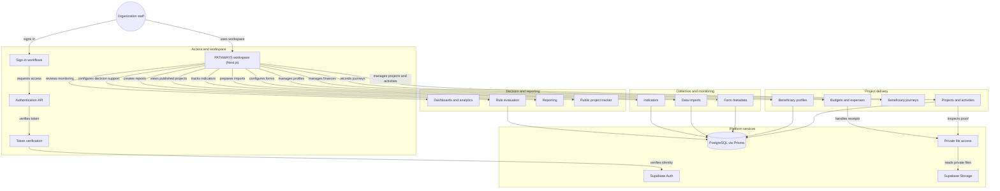

# PATHWAYS

**PATHWAYS** is a metadata-driven project information management platform with deterministic, rule-based decision support for humanitarian and development organizations.

It removes the repeated export, import, verification and mapping that field data need after collection. Project, activity, Beneficiary, indicator, monitoring and reporting information live in one governed workspace, with descriptive dashboards (including SADDD: sex, age and disability disaggregated data), explainable rule-based alerts and predefined recommendation prompts that people review. There is no autonomous AI decision making. PATHWAYS sits beside collection tools such as KOBO and does not replace them.

Do not infer feature completion from documentation alone. The current repository and executed tests are the implementation authority.

## Features

Core (Must-Have):

1. Role-Based Access Control and Workspace Management
2. Project Profile and Activity Tracking
3. Centralized Beneficiary Profile
4. Beneficiary Journey Tracking
5. Digital Data Collection and Preparation
6. Metadata-Driven Data Integration
7. Project Indicator and Monitoring
8. Aggregated Monitoring Dashboard with SADDD Analysis

Supporting: descriptive analytics, rule-based alerts, human-reviewed decision support, reporting and visualization, and a controlled public project tracker.

Six canonical roles apply, including Grant Manager. Frontend visibility is not authorization: every request is checked on the server against the role, permissions, organization and project assignment. Program Manager and Grant Manager see aggregate Beneficiary information only.

## Architecture



Domain modules live in `apps/api/src/modules`. The browser reaches domain data only through the API and Prisma. See the vault note `sdd-pathways` for the full design.

## Tech Stack

| Layer | Technology |
|---|---|
| Runtime and tooling | Node 22, pnpm 11, TypeScript 5 |
| Web | Next.js 15 (App Router), React 19, Tailwind CSS 3, TanStack Query, ECharts |
| API | NestJS 10, Zod, nestjs-pino, helmet; PDF reports through headless Chromium (puppeteer-core) with a pdfkit fallback |
| Data | PostgreSQL 17 with row-level security, Prisma 6 |
| Identity and files | Supabase Auth (including TOTP) and Supabase Storage |
| Hosting and monitoring | Vercel; Sentry on the API |
| Tests | Vitest, Playwright |

Exact versions are in the vault note `sdd-pathways` section 2.4 and the `package.json` files.

## Branches

- `master` is production only. Every push deploys to Vercel production, and nobody develops on it. It holds only what the system needs to run: no AI agent files (`AGENTS.md`, `CLAUDE.md`, `CODEX.md`, `.claude`, `.codex`), no `docs`, no `supabase`, no `scripts/sad` and no `infra` notes. The list lives in `.github/master-excluded-paths`, and CI fails a `master` push that brings any of them back.
- `dev` is for development and holds everything. Feature branches merge into `dev`; a release merges `dev` into `master` and removes the excluded paths in the same merge commit.
- Run and develop PATHWAYS from the `dev` branch. Every step below assumes a `dev` checkout.

## Documentation

All docs live in the AI Memory Vault (`C:\AI Agentic Memory`). On the `dev` branch, `docs/index.md` points to the vault project index; read it, then `AGENTS.md` for the agent build rules and the relevant PRD, SDD, DSD, QAD or RFC for the task. Validate the vault docs with `python .vault/scripts/pathways_docs/check.py` and regenerate `AGENTS.md` with `python .vault/scripts/pathways_docs/materialize.py` (run in the vault; never hand-edit `AGENTS.md`). SSO and AWS hosting are deferred and need explicit authorization (vault note `rfc-pathways-aws-hosting-migration`, a Draft strategy only).

## Local Setup (dev branch)

### What Is In This Repo

PATHWAYS is a pnpm monorepo: one repository holding the web app, the API and the code they share.

- `apps/web`: the Next.js workspace staff open in the browser
- `apps/api`: the NestJS API that talks to PostgreSQL (through Prisma) and Supabase Storage
- `packages/shared`: shared types, enums, constants and Zod schemas
- `packages/config`: environment readers and config helpers
- `packages/imports`: CSV, XLSX and PDF import and export helpers
- `supabase`: the local Supabase stack configuration (dev branch only)
- `scripts`: database seed and maintenance scripts; the SAD review scripts (`scripts/sad`) are on the dev branch only
- `infra`: Docker and the Supabase migration and replay harnesses; the environment notes (`infra/**/*.md`) are on the dev branch only
- `docs`: `docs/index.md` only, a pointer to the document suite in the AI Memory Vault (dev branch only)

### 1. Install The Tools

- Git
- Node.js 22 or newer
- pnpm 11 (`corepack enable` installs the version pinned in `package.json`)
- Docker Desktop (needed for the local Supabase stack)
- VS Code, with the Biome, Prisma, Tailwind CSS IntelliSense and Playwright Test extensions

Quick checks:

```powershell
node -v
pnpm -v
git --version
docker --version
```

### 2. Clone And Install

```powershell
git clone https://github.com/ceezey/PATHWAYS.git
cd PATHWAYS
pnpm install
pnpm --filter @pathways/api prisma:generate
```

Run `prisma:generate` again whenever `apps/api/prisma/schema.prisma` changes, including after a pull or rebase; a stale client fails with misleading 403 errors.

### 3. Create Your Environment Files

```powershell
Copy-Item .env.example .env
Copy-Item apps/web/.env.example apps/web/.env
Copy-Item apps/api/.env.example apps/api/.env
```

These files are ignored by Git. Never commit real keys or full connection URLs. `infra/environment.md` (dev branch) lists which variable belongs to the root, web and API files.

The local stack in step 4 does not read these files. You only fill them in to run against the hosted development database (step 5).

### 4. Run Against The Local Stack (Recommended)

This uses synthetic data only and never touches the hosted databases. Docker must be running.

```powershell
pnpm db:local:start   # start the local Supabase containers
pnpm db:local:reset   # recreate the local database, replay migrations, seed one account per role
pnpm db:local:demo    # optional: add a fictional demonstration workspace
pnpm dev:local        # build and run the API and web against the local stack
```

Then:

- Open `http://127.0.0.1:3000/staff/login` in a private window.
- Passwords for the seeded accounts are written only to the ignored `.tmp/local-seed/` folder.
- A reset keeps the existing local accounts, with their passwords and authenticator setups, as hosted resets do; only accounts it has to create get new passwords.
- Each account enrolls an authenticator app (TOTP) on first sign-in.
- Local email, such as password recovery, appears in Mailpit at `http://127.0.0.1:54324`.

Stop the containers with `pnpm db:local:stop`.

Details:

- `pnpm db:local:reset` acts only on the fixed local container `supabase_db_pathways` (port 54322, 127.0.0.1) and replays the Prisma ledger. Supabase publishes that port on all interfaces with well-known passwords, so keep only synthetic data in it and leave the host firewall enabled.
- `pnpm dev:local` passes local values only to the child processes, so ignored `.env` files are neither used nor changed. Stop other servers on ports 3000 and 4000 first.
- The reset seed writes one organization, program and project and one account per role (plus a second Project Officer), and no Beneficiary, activity or indicator data.
- `pnpm db:local:demo` (run after reset, before `dev:local`) is idempotent and refuses any target that is not the loopback local stack. It fills a fictional Plan International Pilipinas style workspace: six projects, 155 participants, forms, imports, budgets, rules with alerts, reports and F9 data. Content lives in `apps/api/prisma/seeds/local-demo-data.ts` and the `local-demo-stage-*.ts` files beside it.
- Live import files for a presentation are in `apps/api/prisma/seeds/demo-fixtures/`: `beneficiary-registration-borongan.csv` or `.xlsx` (project "Safe Schools for Girls", published registration form, 25 valid rows), `household-profile-followup.csv` (published "Household Profile Update" form, 12 valid rows) and `livelihood-followup-structure.csv` (Collection, Import then extend; its columns become a new draft form).

### 5. Run Against The Hosted Development Database

`pnpm dev` starts the web app and the API together against the hosted devV2 Supabase database and storage. The API uses the runtime database role from `apps/api/.env` and deliberately ignores migration credentials.

1. Ask the developer for the development values: `NEXT_PUBLIC_SUPABASE_URL`, the Supabase publishable or anon key, `SUPABASE_URL`, `SUPABASE_SERVICE_ROLE_KEY` and the runtime `DATABASE_URL`.
2. Paste them into your env files.
3. Run `pnpm dev`.

`DATABASE_URL` is the API runtime identity and `DIRECT_URL` is the migration owner; they must never share a PostgreSQL role. You do not need `DIRECT_URL` to run the app.

How it behaves:

- Web: `http://localhost:3000` (`next dev`, hot reload). API: `http://localhost:4000/api`; it builds `packages/shared`, `packages/imports` and `packages/config` first, then builds once and keeps running, so restart `pnpm dev` after API or `.env` changes, or use `pnpm --filter @pathways/api dev:watch` for automatic reloads.
- `infra/supabase/security-adapter/dev-local.mjs` blanks `DIRECT_URL`, `SHADOW_DATABASE_URL` and `PGPASSWORD` for the running API and redacts secrets from its output.
- Data and uploads land in the hosted devV2 project, the same one the deployed site uses. Use synthetic data only.
- Push to `dev` in batches: each push starts two Vercel builds and the free plan has a build rate limit.
- Docker (`infra/docker/docker-compose.yml`) builds production images with no live reload; use it only for a production-like check.

### 6. Check It Works

- Web: `http://127.0.0.1:3000`
- API health: `http://127.0.0.1:4000/api/health` returns `status: ok`
- API docs: `http://127.0.0.1:4000/api/docs`, only when `ENABLE_SWAGGER=true` in `apps/api/.env`

Both servers listen on 127.0.0.1 only. The web port is fixed at 3000, so stop any other server holding it first. The API port comes from `API_PORT` (default 4000).

### Everyday Commands

```powershell
pnpm lint          # Biome lint and format check
pnpm format        # Biome format, writes changes
pnpm typecheck     # TypeScript in every workspace
pnpm test          # Vitest in every workspace
pnpm build         # build every workspace
pnpm dev:web       # web only
pnpm dev:api       # API only
pnpm --filter @pathways/web e2e   # Playwright end-to-end tests
```

### Fast Checks

For development speed only; the full `./infra/supabase/replay/Replay-Local.ps1 -MigrationBaseline` stays the merge gate.

- Save the replayed cluster once per migration change: `./infra/supabase/replay/Replay-Local.ps1 -MigrationBaseline -SaveTemplate` (writes `.tmp/pathways-replay-template/` with a migrations hash). The runners below refuse a stale template.
- Run a runtime SQL file: `./infra/supabase/replay/Invoke-RuntimeSql.ps1 -File apps/api/prisma/tests/<file>.sql`. Each run copies the template to a disposable loopback cluster on a free port and deletes it afterwards. `project-indicator-dashboard-runtime.sql` is replay-only and fails under this runner.
- Run a DB-backed Vitest suite: `./infra/supabase/replay/Invoke-RuntimeVitest.ps1 -File apps/api/src/modules/<module>/<name>.local.test.ts`. It sets the replay environment for that suite, refuses a file outside its flag map and restores the environment afterwards.
- Run each affected `*.local.test.ts` and `.sql` suite through these runners before review and push.

### End-To-End Tests

1. Stop anything on ports 3000 and 4000, then run `pnpm db:local:start`, `pnpm db:local:reset` and `pnpm db:local:demo`.
2. Start the apps with `pnpm dev:local`, never `pnpm dev`: `pnpm dev` reads the hosted values in `apps/api/.env`, so real sign-in fails with 401 or 503 and never reaches `/auth/mfa`.
3. Run `npx playwright test --config playwright.config.ts` (serial, about 6 minutes) and `npx playwright test --config playwright.auth-navigation.config.ts`.
4. The real sign-in specs reset the `@pathways.example` seed passwords and TOTP factors on every run; their rows accumulate until the next `pnpm db:local:reset`.

### Working Rules

- Use the repository package manager and scripts; copy environment templates rather than committing secrets; use synthetic identities and data.
- Never print full secret-bearing URLs. Keep runtime database credentials, migration credentials, the local shadow database and the restore-test database separate.
- Session start (dev branch): read `docs/index.md` (vault pointer) and `AGENTS.md`, then the registered PRD, SDD, RFC, DSD or QAD documents for the task; inspect the branch and status; confirm the environment target; run the install, build and test commands.
- Session end: run tests, review the diff, and update durable registered docs (in the vault) only when an approved contract or verified repository fact changes.

### Database Safety

- Never run `prisma migrate reset` or `prisma db push`.
- Never point a destructive command at the hosted development or production databases.
- Migrations follow the guardrails in `AGENTS.md` (dev branch) and the vault runbooks `runbook-migration-baseline` and `runbook-backup-restore`; run only database work you were explicitly authorized to run.

### Troubleshooting

- `pnpm install` fails: check `node -v` is 22 or newer and run `corepack enable`.
- Sign-in says the credentials are wrong: any 4xx from the auth endpoint shows that message. Check that the web and API point at the same Supabase project, and that `WEB_ORIGIN` matches the web URL when running against a deployed preview.
- The API fails with 403 on every request after a pull: regenerate the Prisma client (step 2).
- The API cannot reach the database: check the runtime `DATABASE_URL`, or for the local stack check that Docker is running and `pnpm db:local:start` succeeded.
- Storage fails: make sure the buckets exist and their names match the env values.
- A port is busy: stop the other dev server; `pnpm dev:local --api-only` with `PATHWAYS_LOCAL_API_PORT` runs only the API on another port.

### Useful Documents (dev branch)

- `infra/environment.md`: environment variable guide
- `infra/supabase/HUMAN_SETUP.md`: human-only Supabase project setup
- `infra/supabase/developer-mfa.md`: authenticator (TOTP) setup for developers
